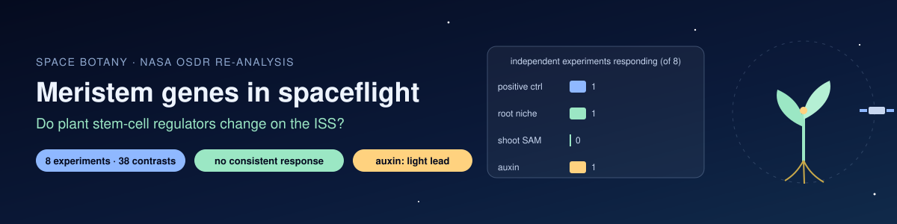
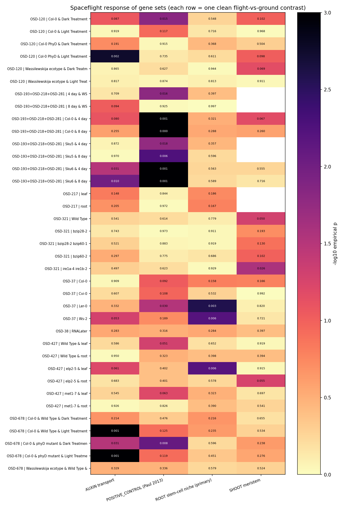

# 🌱🚀 Space Botany: Do Plant Stem-Cell Genes Respond to Spaceflight?

   

**Author:** Riddhika D

## Question
Plants grow from **meristems**, small groups of stem cells at the root and shoot tips. When *Arabidopsis* grows in space, do the genes that keep these stem cells working change compared with plants grown on the ground?

## Data
- **Source:** NASA Open Science Data Repository (OSDR / GeneLab). The notebook automatically found **18** *Arabidopsis* RNA-seq studies with a spaceflight factor, and **14** of them had GeneLab's processed results.
- **Clean comparisons only:** flight vs ground with **everything else the same** (genotype, tissue, light, age). This gave **42** contrasts.
- **Independence check:** some OSDR entries are the same flight processed again. OSD-218 matched OSD-193 and OSD-281 with log2FC correlation r = 0.94–0.98, so its 4 duplicate contrasts were removed and the three studies were counted as **one experiment (APEX-02)**.
- **Final data:** **38 contrasts from 8 independent experiments**:
  - OSD-37
  - OSD-38
  - OSD-120
  - APEX-02 (OSD-193, OSD-218, OSD-281)
  - OSD-217
  - OSD-321
  - OSD-427
  - OSD-678

## Method (fixed before looking at results)
| | |
|---|---|
| **Primary set** | Root stem-cell niche: PLT1, PLT2, PLT3, BBM, WOX5, SCR, SHR, CLE40, ACR4 |
| **Secondary sets** | Shoot meristem (WUS, CLV1, CLV3, STM); auxin transport (PIN1/2/3/4/7, AUX1, LAX3) |
| **Positive control** | DDF1, DREB2A, TCH4, JAZ7, ELIP1, confirmed by RT-qPCR in three flights (Paul et al. 2013) |
| **Score** | Mean \|z\| of the set's genes, from GeneLab's p-values |
| **Null** | 10,000 random gene sets matched on expression level |
| **Rule** | A set "responds" in an experiment if p < 0.05 in at least half its contrasts. An overall claim needs **≥ 2 independent experiments** |

## Results

| Gene set | Contrasts with p < 0.05 | Experiments responding | Verdict |
|---|---|---|---|
| Positive control (Paul 2013) | 11 / 38 | 1 / 8 (APEX-02 only) | ❌ **Does not replicate** |
| **Root stem-cell niche (primary)** | 3 / 38 (about 2 expected by chance) | 1 / 8 (OSD-37) | No consistent response |
| Shoot meristem | 1 / 32 | 0 / 7 | No consistent response |
| Auxin transport | 7 / 38 | 1 / 8 (OSD-678) | No consistent response |

## What this means
1. **No gene set responds consistently across independent spaceflight experiments.** That includes the five "known" spaceflight genes, which replicated in only one of eight experiments.
2. **The null for the meristem genes is therefore weak evidence.** The method could not reproduce the known markers either, so we **cannot** conclude that meristem genes are stable in space. We can only say that no consistent change is visible in these data.
3. **Spaceflight responses are highly experiment-specific.** Hardware, light, age, tissue and genotype differ between flights, and the gene responses differ with them. This fits earlier reports that different *Arabidopsis* spaceflight experiments share few changed genes.
4. **One lead is worth following:** auxin carriers (PIN3, PIN4, PIN7, AUX1) were lower in **light-grown** plants in OSD-678 (all three genotypes, p ≤ 0.004). The light-grown phyD mutant in OSD-120 showed the same pattern (p = 0.002), but light-grown Col-0 and WS in OSD-120 did not. OSD-120 and OSD-678 share a design but are separate data (r < 0.9). Dark-grown plants did not show this. *Hypothesis: light conditions shape the auxin-transport response to spaceflight.*

## Limits
- Most samples are **whole seedlings, whole roots or leaves**. The stem-cell niche is a few dozen cells, so its signal is diluted.
- The gene sets are small (4–9 genes). Expression was measured, but not cell division or meristem size.
- The independence check uses a fixed threshold (r > 0.9). Studies that share hardware or seed stocks may still be related.

## Correction notice
Earlier notebooks in this project used **simulated data**:
- random counts
- p-values that were **deliberately increased** for meristem and auxin genes
- an enrichment (GSEA) table with **hand-typed numbers**

Those outputs were not real results and have been removed. This analysis replaces them with real NASA data. Versions v2.0–v2.2 of this notebook counted reverse-direction contrasts twice (v2.2 fixed this). They also treated re-processed copies of the same flight as independent; v2.3, the current version, fixes this.

## Run it
Upload `space_botany_meristem_spaceflight.ipynb` to Google Colab, then **Runtime → Run all** (10–20 min). Everything downloads from NASA automatically.

## Files
| File | Purpose |
|---|---|
| `space_botany_meristem_spaceflight.ipynb` | Full analysis (v2.3) |
| `space_botany_meristem_spaceflight_RUN.ipynb` | Same notebook with outputs |
| `space_meristem_heatmap.png` | p-value heatmap, one row per contrast |
| `space_meristem_set_tests.csv` | All test results, with per-gene log2 fold changes |

## References
- Paul A-L, Zupanska AK, Schultz ER, Ferl RJ (2013). Organ-specific remodeling of the Arabidopsis transcriptome in response to spaceflight. *BMC Plant Biology* 13:112.
- Califar B, Sng NJ, Zupanska A, Paul A-L, Ferl RJ (2020). Root skewing-associated genes impact the spaceflight response of *Arabidopsis thaliana*. *Frontiers in Plant Science* 11:239.
- NASA Open Science Data Repository: https://osdr.nasa.gov
